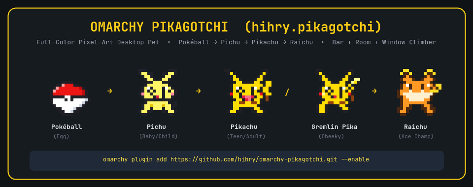
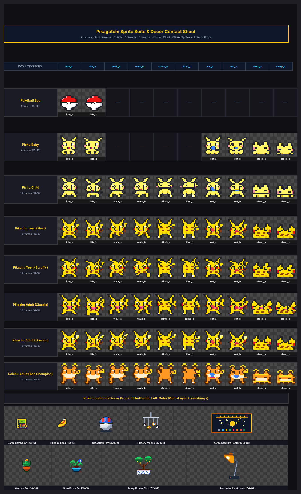

# Omarchy Pikagotchi (`hihry.pikagotchi`)

A **full-color pixel-art Pokémon desktop pet** for [Omarchy](https://omarchy.org/) (`omarchy-shell` / Quickshell), built on the [Omagotchi](https://github.com/SLcode777/omagotchi) virtual pet engine.

It starts as a wobbling **Pokéball** in your status bar, hatches into **Pichu**, grows into **Pikachu** inside a furnished Pokémon room, and—with top-tier care—evolves into **Raichu**! Let it out to roam your desktop and watch it **walk, nap, and climb up and across your Hyprland windows** in crisp nearest-neighbor RGBA pixel art.



---

## Installation

Install and enable directly via the `omarchy` CLI:

```bash
omarchy plugin add https://github.com/hihry/omarchy-pikagotchi.git --enable
```

### Already using `slcode777.omagotchi`? (Zero Progress Lost!)
`hihry.pikagotchi` reads the same pet state file (`~/.local/state/omarchy/omagotchi-state.json`), so **your existing pet's age, generation, and stage carry over automatically**! Simply disable the original plugin first so only one runs at a time:

```bash
omarchy plugin disable slcode777.omagotchi
omarchy plugin add https://github.com/hihry/omarchy-pikagotchi.git --enable
```

---

## Evolution Chart

Growth tracks **active shell minutes** (sleeping/powered-off time never starves your pet), and evolution branches depend on your average care score across each stage:

| Stage | Form ID | Pokémon | Unlocks At | Care Requirement |
| :--- | :--- | :--- | :--- | :--- |
| **Egg** | `egg` | **Pokéball** | Start | Wobbles gently under the incubator lamp |
| **Baby** | `baby` | **Baby Pichu** | `5 min` | Hatches hungry & sleepy — stays in its nursery |
| **Child** | `child` | **Pichu** | `65 min` | Unlocks **Go play** desktop roaming & window climbing! |
| **Teen** | `teen_neat` / `teen_scruffy` | **Pikachu** *(Neat / Scruffy)* | `~8 active hrs` | `avg care ≥ 55` → Neat Pikachu; `< 55` → Scruffy Pikachu |
| **Adult** | `adult_ok` / `adult_gremlin` | **Pikachu** *(Classic / Gremlin)* | `~24 active hrs` | Standard or mischievous care path |
| **Adult (Ace)** | `adult_ace` | **Raichu** *(Champion)* | `~24 active hrs` | High care from a Neat Teen evolves Pikachu into **Raichu**! |

### Complete Sprite & Pokémon Room Decor Suite

<p align="center">
  
</p>

Includes **68 full-color RGBA pet animation frames** (`idle`, `walk`, `climb`, `eat`, `sleep`) plus **9 custom Pokémon room furnishings** (Yellow Game Boy Color, Pikachu tail sock, Great Ball toy, Poké-nursery mobile, Kanto Stadium 8-Badge wall poster, Cacnea pot, Oran Berry pot, Berry Bonsai tree, and warm incubator lamp).

---

## Needs & Care

| Need | Emote | Rises With | How to Care |
| :--- | :-: | :--- | :--- |
| **Hunger** | <picture><source media="(prefers-color-scheme: dark)" srcset="docs/emotes/hungry-dark.png"></picture> | Active time *(faster when system updates are pending)* | Click **Feed** to give it an Oran Berry |
| **Hygiene** | <picture><source media="(prefers-color-scheme: dark)" srcset="docs/emotes/dirty-dark.png"></picture> | Active time *(faster when orphaned packages linger)* | **Press and scrub across your Pokémon** with the mouse inside its room |
| **Energy** | <picture><source media="(prefers-color-scheme: dark)" srcset="docs/emotes/sleepy-dark.png"></picture> | Active time *(faster while roaming)* | Let it nap — it curls up automatically when tired |
| **Fun** | <picture><source media="(prefers-color-scheme: dark)" srcset="docs/emotes/bored-dark.png"></picture> | Active time | Click **Go play** so it roams your desktop & climbs windows |
| **Affection** | <picture><source media="(prefers-color-scheme: dark)" srcset="docs/emotes/sad-dark.png"></picture> | Active time *(or dropping from too high)* | Click to **pet** it (in its room, while roaming, or middle-click the bar icon!) |

---

## Desktop Roaming & Window Climbing

- **Bar Interactions:**
  - **Left-click** the bar icon to open/close Pikachu's room panel.
  - **Middle-click** the bar icon for a quick head-pat without opening the panel.
- **Window Climbing:** From the `child` (**Pichu**) stage onward, click **Go play**. A tractor beam lowers your Pokémon onto the bottom edge of your monitor, where it wanders, scales the sides of open Hyprland windows, strolls across titlebars, rides windows as you move them, and naps on top of your terminal.
- **Pick Up & Carry:** Press and drag your roaming Pokémon to carry it anywhere on screen (careful not to drop it from too high, or it lands stunned and wants extra cuddles!). Click **Come home** in the panel to beam it back.
- **Multi-Monitor Pinning:** Click the cogwheel icon in the panel header to pin roaming to a specific Hyprland monitor (e.g. `eDP-1` or `DP-1`), or adjust sound effects volume with the speaker slider at the bottom (`0` mutes).

---

## Customizing Sprites

All sprites live in `assets/sprites/` as crisp RGBA PNGs (`16×16` for pets, `16×16` to `96×48` for room decor) and are generated from pure-Python pixel matrices in `tools/`:

```bash
python3 tools/generate_pikagotchi_sprites.py
```

---

## Update & Uninstall

```bash
# Pull latest updates
omarchy plugin update hihry.pikagotchi

# Remove plugin
omarchy plugin remove hihry.pikagotchi
```

State files live at `~/.local/state/omarchy/omagotchi-state.json` and `~/.local/state/omarchy/omagotchi-settings.json`.

---

## Credits & License

- **Code & Original Engine:** Based on [SLcode777/omagotchi](https://github.com/SLcode777/omagotchi) by SLcode777 (MIT License). Full-color RGBA renderer, Pokémon evolution sprite suite, and room decor by [Himanshu Ravindra Iwanati (`hihry`)](https://github.com/hihry).
- **Audio:** Creative Commons sound effects from Freesound — see [CREDITS.md](CREDITS.md) for per-file attributions.
- **Disclaimer:** *Pokémon*, *Pikachu*, *Pichu*, *Raichu*, and *Poké Ball* are trademarks of Nintendo / Creatures Inc. / GAME FREAK inc. Non-commercial fan project.
